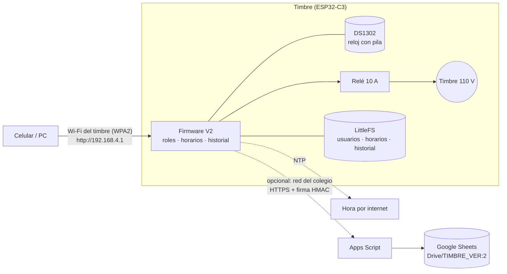

# 🔔 Timbre Alba V2

Timbre escolar programable con **ESP32-C3 SuperMini**. Lo controla un panel web con roles y queda historial de todo. Sirve para colegios e instituciones que necesitan marcar la entrada, los cambios de clase, los descansos y la salida.

- Funciona **sin internet**: el timbre crea su propia red Wi-Fi y sirve el panel en `http://192.168.4.1`.
- Tiene **dos roles**: el administrador maneja todo; el usuario programa horarios y puede tocar el timbre a mano.
- Cada horario puede sonar **distinto cada día** o igual de lunes a viernes. También permite copiar un día completo a otros y editar solo un día.
- Guarda un **historial de auditoría** con quién hizo qué, cuándo y desde qué IP. Se puede exportar en CSV y respaldar con firma en Google Sheets.
- Incluye **copias de seguridad cifradas** (AES-256-GCM) para restaurar toda la configuración desde el panel.
- **El repositorio no contiene ninguna contraseña.** Ver [SECURITY.md](SECURITY.md).

---

## Arquitectura



---

## 1. Materiales

| Componente | Cant. | Valor aprox. (COP) | Nota |
|---|---|---|---|
| ESP32-C3 SuperMini | 1 | 10.000 | |
| Módulo RTC DS1302 + pila CR2032 | 1 | 10.000 | Ver mejora DS3231 abajo |
| Módulo relé 1 canal 5 V (10 A/250 VAC) | 1 | 12.000 | Con optoacoplador y jumper H/L |
| Cargador de celular 5 V ≥ 1 A | 1 | 12.000 | Alimenta placa y relé |
| Caja (impresa en 3D, `hardware/caja_timbre_v1.stl`) | 1 | 12.000 | 172 × 105 × 33 mm en total |
| Cables, borneras, jumpers | lote | 7.000 | |
| **Total** | | **≈ 63.000** | Precios de referencia del presupuesto inicial |

**Mejoras recomendadas** (precios aproximados, verifíquelos en su proveedor):

- **DS3231 en vez de DS1302.** El DS1302 puede adelantarse o atrasarse varios minutos al mes; el DS3231 se desvía cerca de 1 minuto al año. Si el timbre se conecta a la red del colegio, el NTP corrige la hora de todos modos.
- **Portafusible + fusible de 1 A** en la fase de 110 V.
- **Varistor (MOV) 275 VAC** en paralelo con la bobina del timbre. Alarga la vida de los contactos del relé.
- **Bornera de tornillo** para la entrada de 110 V. Sin empalmes con cinta.

## 2. Conexiones

| Elemento | Pin del elemento | Pin ESP32-C3 SuperMini |
|---|---|---|
| DS1302 | VCC | 3V3 |
| | GND | GND |
| | CLK | GPIO 4 |
| | DAT (I/O) | GPIO 5 |
| | RST (CE) | GPIO 6 |
| Módulo relé | IN | GPIO 8 *(ver nota)* |
| | VCC | 5V |
| | GND | GND |
| Timbre escolar | Fase | Contactos **COM** y **NO** del relé |

> ⚠️ **110 V mata.** La red eléctrica pasa **solo** por los contactos COM/NO del relé y nunca toca la placa. La instalación a 110 V debe hacerla o revisarla un electricista. Detalles y recomendaciones en [docs/cableado.md](docs/cableado.md).

> **Nota GPIO 8:** es un pin de arranque y tiene el LED azul de la placa. Funciona, pero conviene mover el relé a **GPIO 10** y cambiar `PIN_RELAY` en `config.h`. Si el timbre suena un instante al encender, esa es la causa.

## 3. Instalar el firmware (Arduino IDE 2)

1. **Placa:** en *Archivo → Preferencias → URLs adicionales* agregue
   `https://espressif.github.io/arduino-esp32/package_esp32_index.json`.
   Después, en *Gestor de placas*, instale **esp32 de Espressif 3.3.x** (probado con 3.3.12).
2. **Bibliotecas** (*Gestor de bibliotecas*): **Rtc by Makuna 2.5.x** y **ArduinoJson 7.x**.
3. **Secretos:** en `firmware/Timbre_Alba_V2/` copie `secrets.example.h` como **`secrets.h`** y escriba los valores reales: red, administradores iniciales y contraseña inicial. Ese archivo **nunca** se sube a GitHub (`.gitignore` lo bloquea).
4. Abra `firmware/Timbre_Alba_V2/Timbre_Alba_V2.ino` y configure *Herramientas*:

   | Opción | Valor |
   |---|---|
   | Placa | **ESP32C3 Dev Module** |
   | USB CDC On Boot | **Enabled** |
   | Partition Scheme | **No OTA (2MB APP/2MB SPIFFS)** ← obligatorio |
   | Flash Size | 4MB |

5. Suba el programa. Si la placa no entra en modo de carga, mantenga **BOOT**, toque **RESET** y suelte BOOT.
6. Abra el *Monitor serie* a 115200 baudios. Debe aparecer `=== Timbre Alba v2.0.0 ===` junto con la red y la IP.

> La V1 usaba otra zona de memoria, así que la V2 arranca desde cero. Los horarios de la V1 se vuelven a crear en el panel.

## 4. Primer uso

1. Conéctese a la red Wi-Fi del timbre con la clave de `secrets.h`. En la mayoría de celulares el panel se abre solo; si no, entre a `http://192.168.4.1`.
2. Ingrese con un administrador inicial. El nombre no distingue mayúsculas: `rector` queda como **Rector**. El sistema **obliga a crear una contraseña personal** (mínimo 10 caracteres, con letras y números) y cada administrador inicial debe hacerlo en su primer ingreso.
3. En **Red y equipo**, cambie la clave Wi-Fi de fábrica. Mientras no lo haga, el panel lo seguirá avisando.
4. En **Reloj**, verifique la fecha y la hora o use “Usar la hora de este dispositivo”.
5. Programe los **Horarios** y cree los **Usuarios** que necesite.
6. En **Copias y respaldo**, descargue la primera **copia de seguridad**.

### Qué puede hacer cada rol

| Función | Administrador | Usuario |
|---|:---:|:---:|
| Ver estado, próximo timbre, timbres del día | ✅ | ✅ |
| Programar, editar, copiar y pausar horarios | ✅ | ✅ |
| Tocar o detener el timbre manualmente | ✅ | ✅ |
| Cambiar su propia contraseña | ✅ | ✅ |
| Usuarios (crear, rol, activar, restablecer, desbloquear, eliminar) | ✅ | ❌ |
| Historial de auditoría y exportar CSV | ✅ | ❌ |
| Fecha y hora, modo automático | ✅ | ❌ |
| Red Wi-Fi (nombre, clave, IP), red institucional | ✅ | ❌ |
| Copias de seguridad y restauración | ✅ | ❌ |
| Respaldo en Google Sheets, sistema y reinicio | ✅ | ❌ |

Los permisos los aplica **el equipo** en cada petición: aunque alguien modifique la página en su navegador, el timbre rechaza la acción y la deja en el historial como *Acceso denegado*.

## 5. Respaldo del historial en Google Sheets (opcional)

Para esto el timbre necesita salir a internet por la red del colegio.

1. Entre a [script.google.com](https://script.google.com) y cree un **proyecto nuevo**. Pegue `apps-script/Code.gs`. Active *Configuración del proyecto → Mostrar appsscript.json* y pegue `apps-script/appsscript.json`.
2. Ejecute la función **`instalar`** y autorice los permisos. Esto crea en su Drive:
   ```
   TIMBRE_VER:2/
   ├── 01_Base_de_datos/       Google Sheet (Historial, Equipos, Léame)
   ├── 02_Apps_Script/         este proyecto
   ├── 03_Copias_de_seguridad/ guarde aquí las copias del timbre
   ├── 04_Reportes/            CSV mensual automático
   └── 05_Documentacion/       LEEME con enlaces
   ```
   El registro de ejecución muestra la **clave secreta** una sola vez. Si la necesita de nuevo, use `mostrarClave()`.
3. Vaya a *Implementar → Nueva implementación → Aplicación web*, con **Ejecutar como: Yo** y **Acceso: Cualquier persona**. Copie la URL que termina en `/exec`.
4. En el panel del timbre, entre a **Red y equipo**, active la red institucional y guarde.
5. En **Copias y respaldo → Google Sheets**, pegue la URL y la clave, active el respaldo y pulse **Probar conexión**.

“Cualquier persona” es necesario porque el timbre no puede iniciar sesión en Google. La protección es la **firma HMAC**: sin la clave, nadie puede escribir en la hoja. Si la clave se filtra, ejecute `rotarClave()`.

## 6. Copias de seguridad y recuperación

**Crear una copia:** vaya a *Copias y respaldo → Crear copia*, escriba una frase de 12 o más caracteres y descargue el `.json`. Guárdelo en `TIMBRE_VER:2/03_Copias_de_seguridad`.

La copia incluye usuarios (con sus contraseñas protegidas), horarios, red, modo automático y la integración con Sheets. Sale **cifrada**: sin la frase es ilegible, y si alguien la modifica, el timbre la rechaza. **Guarde la frase fuera del timbre**, porque nadie puede recuperarla. Para comprobar que una copia se abre sin tocar el equipo, use `python3 tools/backup_tool.py verificar archivo.json`.

**Recuperar tras un daño o con una placa nueva:**

1. Cargue el firmware (sección 3) en la placa nueva o reparada.
2. Ingrese con un administrador inicial y cree la contraseña personal que exige el sistema.
3. En *Copias y respaldo → Restaurar*, elija el archivo, escriba la frase y pulse **Verificar copia**. Revise el resumen.
4. Pulse **Restaurar esta copia** y escriba `RESTAURAR`. El equipo se reinicia con la red, los usuarios y los horarios de la copia.

El historial **no se sobrescribe**: es evidencia. Queda en el equipo y en Google Sheets.

**Restaurar de fábrica:** con el timbre encendido, mantenga el botón **BOOT** 10 segundos. Se restablecen la red y los administradores iniciales; los horarios y el historial se conservan. Requiere acceso físico al equipo.

## 7. Estructura del repositorio

```
firmware/Timbre_Alba_V2/
  Timbre_Alba_V2.ino   programa principal
  config.h             pines y límites (no secreto)
  types.h              estructuras de datos
  crypto_util.h        PBKDF2, HMAC y AES-GCM (mbedtls)
  google_roots.h       certificados raíz PÚBLICOS de Google (TLS)
  web_assets.h         interfaz comprimida (generada por tools/build_web.py)
  secrets.example.h    plantilla → copiar a secrets.h (ignorado por Git)
web/                   fuente del panel: index.html, app.css, app.js
apps-script/           Code.gs + appsscript.json (Google Sheets / Drive)
tools/                 generador web, simulador, pruebas, herramienta de copias
hardware/              caja imprimible (STL)
docs/                  cableado y seguridad eléctrica
```

## 8. Desarrollo y pruebas

```bash
python3 tools/build_web.py                       # tras editar web/ → regenera web_assets.h
MOCK_PASSWORD="Clave-de-Prueba-1" python3 tools/mock_server.py   # panel sin placa en http://localhost:8080
python3 tools/test_ui.py                         # 28 pruebas de punta a punta (Playwright)
node tools/test_apps_script.js                   # 22 pruebas de Apps Script (Drive, firma, duplicados)
```

GitHub Actions ejecuta todo esto y además **gitleaks** en cada envío (`.github/workflows/ci.yml`).

## 9. Solución de problemas

| Síntoma | Causa probable | Solución |
|---|---|---|
| “Sketch too big” al compilar | Partición por defecto | *Partition Scheme* → **No OTA (2MB APP/2MB SPIFFS)** |
| Falta `secrets.h` | No se creó la copia | Copie `secrets.example.h` como `secrets.h` |
| No aparece la red Wi-Fi | Antena débil de la SuperMini, o clave de menos de 8 caracteres | Acerque el celular; revise `INITIAL_AP_PASSWORD` |
| Panel: “Reloj sin hora” | Pila del DS1302 agotada o cableado | Cambie la CR2032, revise los pines 4/5/6 y ajuste la hora |
| La hora se corre cada semana | Deriva normal del DS1302 | Active la red institucional (NTP) o cambie a DS3231 |
| El timbre suena al encender | GPIO 8 es pin de arranque | Mueva el relé a GPIO 10 (`config.h`) |
| El relé hace clic pero el timbre no suena | Cableado de 110 V | Use COM y **NO** (no NC); revise el fusible |
| “Cuenta bloqueada” | 5 intentos fallidos | Espere o pida a un administrador que la desbloquee |
| Último reinicio: “Bajo voltaje” | Cargador débil | Use una fuente de 5 V y al menos 1 A |
| Sheets: “Firma inválida” | Clave distinta | Copie de nuevo la clave de `mostrarClave()` |
| Sheets: “Hora desfasada” | Sin NTP | Revise que la red institucional tenga internet |

## 10. Próximas mejoras sugeridas

- **Calendario de festivos y vacaciones** para suspender timbres por fecha.
- **Perfiles de horario** (jornada normal, jornada corta, evaluaciones) que se activan con un clic.
- **HTTPS en el panel** (`esp_https_server`), con el aviso de certificado propio que eso implica en el navegador.
- **Actualización OTA firmada** desde el panel. Requiere usar Flash Encryption y Secure Boot (ver SECURITY.md).
- **DS3231** con compensación de temperatura.

---
Licencia: ver [LICENSE](LICENSE). Seguridad: ver [SECURITY.md](SECURITY.md).
